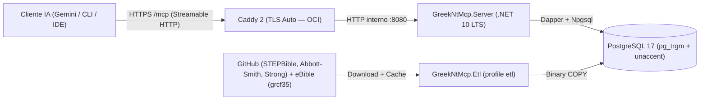

# Greek NT Exegesis MCP Server


-4169E1?logo=postgresql&logoColor=white)

-2496ED?logo=docker&logoColor=white)

Servidor **Model Context Protocol (MCP)** dedicado à **exegese acadêmica do Novo Testamento Grego**, construído em **C# / .NET 10 (LTS)** e **PostgreSQL 17**, 100% isolado via **Docker Compose** e pronto para rodar localmente ou hospedado na **Oracle Cloud Always Free (OCI)**.

O objetivo do projeto é conectar clientes de IA (Gemini, Antigravity, Gemini CLI e outros clientes compatíveis com MCP) a um motor lexicográfico, morfológico e de concordância determinístico — garantindo **zero alucinação** nas definições, ocorrências textuais, códigos de Strong e análises morfológicas de Robinson.

---

## O que você pode perguntar (Exemplos de Uso)

Uma vez conectado ao seu cliente de IA, basta perguntar em linguagem natural. A IA seleciona e encadeia automaticamente as ferramentas do servidor:

### 1. Exegese e análise palavra por palavra (`parse_verse`)
- *"Faça a análise morfológica completa de João 1:1–5 na Família 35."*
- *"Analise 1 Coríntios 13:4–7 palavra por palavra, explicando tempos, vozes e modos verbais em português."*
- *"Mostre 1 João 5:7–8 na Família 35 e compare as variantes com o Textus Receptus, o Bizantino e o NA28."*
- *"Qual a diferença textual entre Família 35, TR e NA28 em João 1:18 ou 1 Timóteo 3:16?"*

### 2. Estudo lexical aprofundado (`lookup_strong`)
- *"Dê o estudo léxico completo de `G3056` (λόγος) com etimologia, Abbott-Smith e equivalentes na LXX."*
- *"Mostre o verbete integral do LSJ para `G0026` (ἀγάπη) e `G5485` (χάρις)."*
- *"Quais sinônimos clássicos e equivalentes hebraicos (LXX) o Abbott-Smith lista para `G3341` (μετάνοια)?"*
- *"Quantas vezes `G3056` ocorre na Família 35 versus no TR, no Bizantino e no NA28?"*

### 3. Descoberta de lemas gregos (`search_lemma`)
- *"Qual o código Strong e o lema grego para `agape` ou `charis`?"*
- *"Busque palavras gregas do NT ligadas a `covenant`, `grace`, `repentance` ou `righteousness`."*
- *"Procure por `λογος` ou `αγαπη` (mesmo sem acentos, espíritos ou com sigma final/medial)."*

### 4. Concordância completa e uso contextual no NT (`word_occurrences`)
- *"Liste todas as ocorrências de ἀγάπη (`G0026`) em 1 Coríntios na Família 35, com a forma flexionada e morfologia em cada versículo."*
- *"Como Paulo usa `G1343` (δικαιοσύνη) na carta aos Romanos?"*
- *"Mostre todas as ocorrências de `G3056` no Evangelho de João no Textus Receptus."*

### 5. Estudos exegéticos compostos (múltiplas tools encadeadas)
- *"Faça um estudo exegético de Efésios 2:8–9: decomponha o grego, investigue os termos-chave (χάρις, πίστις, δῶρον) no Abbott-Smith e no LSJ, e mostre como Paulo usa esses termos em Romanos."*
- *"Compare o uso de ἀγαπάω (`G0025`) e φιλέω (`G5368`) em João 21:15–17 com base nos léxicos e nas ocorrências no Evangelho de João."*

<details>
<summary><strong>Exemplo real de saída da tool <code>parse_verse("Jo 1:1")</code></strong></summary>

```markdown
# Análise Morfológica — João 1:1 (John 1:1)
- **Edição Base:** Família 35 (F35 — Wilbur Pickering)

## João 1:1
> Ἐν ἀρχῇ ἦν ὁ Λόγος, καὶ ὁ Λόγος ἦν πρὸς τὸν Θεόν, καὶ Θεὸς ἦν ὁ Λόγος.

| # | Forma | Translit. | Lema | Strong | Morfologia (Robinson + PT) | Glosa |
| :---: | :--- | :--- | :--- | :--- | :--- | :--- |
| 1 | **Ἐν** | `En` | ἐν | `G1722` | `PREP` (Preposição) | In [the] |
| 2 | **ἀρχῇ** | `archē` | ἀρχή | `G0746` | `N-DSF` (Substantivo, Dativo Singular Feminino) | beginning |
| 3 | **ἦν** | `ēn` | εἰμί | `G1510` + `G2258` | `V-IAI-3S` (Verbo, Imperfeito Ativa Indicativo, 3ª Pessoa do Singular) | was |
| 4 | **ὁ** | `ho` | ὁ | `G3588` | `T-NSM` (Artigo Definido, Nominativo Singular Masculino) | the |
| 5 | **Λόγος** | `logos` | λόγος | `G3056` | `N-NSM` (Substantivo, Nominativo Singular Masculino) | Word, |
```

</details>

---

## Fontes de Dados Abertas e Atribuição

Todo o corpus é baixado de commits/versões fixadas pelo pipeline ETL ([datasets.json](src/GreekNtMcp.Etl/datasets.json)) e carregado no PostgreSQL via `COPY` binário:

| Dataset | Volume Ingerido | Conteúdo | Fonte / Licença |
| :--- | :---: | :--- | :--- |
| **Família 35 (`f35` — Padrão)** | 7.954 versos / 139.854 tokens | Texto Grego do NT segundo a Família 35 (*Wilbur N. Pickering*), com alinhamento determinístico conservador contra o TAGNT (`98,33%` alinhado; variantes exclusivas ambíguas nunca recebem etiqueta inferida) | [eBible.org (`grcf35`)](https://ebible.org/find/details.php?id=grcf35) |
| **STEPBible `TAGNT`** | 142.095 tokens | Texto grego amalgamado (`TR`, `Byz`, `NA28`, `SBL`, `WH`, `Treg`, `Tyn`) com etiquetagem palavra por palavra (Strong estendido + morfologia de Robinson) | [STEPBible/STEPBible-Data](https://github.com/STEPBible/STEPBible-Data) (CC BY 4.0) |
| **STEPBible `TBESG`** | 11.035 entradas | *Translators Brief Lexicon of Extended Strongs for Greek* | [STEPBible/STEPBible-Data](https://github.com/STEPBible/STEPBible-Data) (CC BY 4.0) |
| **STEPBible `TFLSJ`** | 10.957 verbetes | *Translators Formatted Full LSJ Bible Lexicon* (0–5624 + extra) | [STEPBible/STEPBible-Data](https://github.com/STEPBible/STEPBible-Data) (CC BY 4.0) |
| **Abbott-Smith** | 5.896 verbetes | *A Manual Greek Lexicon of the New Testament* (TEI XML: acepções, sinônimos e equivalentes hebraicos da LXX) | [translatable-exegetical-tools/Abbott-Smith](https://github.com/translatable-exegetical-tools/Abbott-Smith) |
| **Strong's Greek** | 5.624 verbetes | Dicionário original de Strong com grego politônico, transliteração e etimologia | [morphgnt/strongs-dictionary-xml](https://github.com/morphgnt/strongs-dictionary-xml) |

> **Atribuição:** Dados léxicos e textuais STEPBible criados por Tyndale House Cambridge / [STEPBible.org](https://www.stepbible.org/) sob licença **CC BY 4.0** ([github.com/STEPBible/STEPBible-Data](https://github.com/STEPBible/STEPBible-Data)).

---

## Ferramentas MCP Expostas (`/mcp`)

| Tool | Parâmetros | Descrição |
| :--- | :--- | :--- |
| **`lookup_strong`** | `code`, `detail_level="standard"`, `lsj_offset=0`, `lsj_max_chars=12000` | Retorna lema, transliteração, contagens por edição (**F35 / TR / Byz / NA28**), resumo TBESG, etimologia e definição de Strong, **Abbott-Smith completo** e **LSJ (TFLSJ)** integral sob demanda (`brief` \| `standard` \| `full`). |
| **`search_lemma`** | `query`, `fuzzy=true`, `limit=15` | Busca ranqueada (exato → prefixo → FTS → `pg_trgm` fuzzy) por grego politônico ou sem diacríticos (`ς` unificado com `σ`), transliteração ASCII ou glosa em inglês. |
| **`word_occurrences`** | `lemma_or_strong`, `edition="f35"`, `book=null`, `limit=30`, `offset=0` | Concordância no NT com distribuição por livro, versículo grego com forma flexionada em **negrito** e morfologia Robinson decodificada em português. Edições: `f35` *(padrão)*, `tr`, `byz`, `na28`, `sbl`, `all`. |
| **`parse_verse`** | `reference`, `edition="f35"`, `include_variants=true` | Análise palavra por palavra de um versículo ou faixa (até 30 versos, PT/EN) + bloco de comparação textual entre **Família 35**, **TR**, **Bizantino** e **NA28**. |

---

## Arquitetura



```text
.
├── db/init/001_schema.sql          # Extensões, tabelas e índices PostgreSQL 17
├── src/
│   ├── GreekNtMcp.Domain/          # Normalização politônica, Strongs, parser PT/EN, decodificador Robinson PT
│   ├── GreekNtMcp.Infrastructure/  # Repositórios Dapper/Npgsql com busca ranqueada e aparato textual
│   ├── GreekNtMcp.Etl/             # Downloader versionado, parsers XML/TSV e alinhador determinístico F35
│   ├── GreekNtMcp.Server/          # ASP.NET Core 10, Streamable HTTP (/mcp), Bearer Auth e /health
│   └── GreekNtMcp.Tests/           # Suíte xUnit (34 testes)
├── Dockerfile.server               # Multi-arch .NET 10 Alpine + icu-libs
├── Dockerfile.etl                  # Multi-arch .NET 10 Alpine + icu-libs
├── Dockerfile.test                 # Runner xUnit isolado em container
├── docker-compose.yml              # Ambiente local completo
├── docker-compose.oci.yml          # Override de produção para Oracle Cloud Always Free (OCI)
└── Caddyfile                       # Reverse proxy HTTPS Let's Encrypt sem buffering para streaming MCP
```

---

## Execução Local (Docker Compose — Zero Instalação no Host)

```bash
git clone <url-do-seu-repo>
cd mcp-exegesis
cp .env.example .env

# 1. Subir o PostgreSQL 17
docker compose up -d db

# 2. Executar o ETL completo (baixa datasets, parseia e carrega em ~35s)
docker compose --profile etl run --rm --build etl

# 3. Subir o servidor MCP em http://localhost:8080/mcp
docker compose up -d --build mcp-server

# 4. Verificar saúde e contagens do banco
curl http://localhost:8080/health
```

### Rodar Testes Unitários em Container

```bash
docker build -f Dockerfile.test -t greek-nt-mcp-tests . && docker run --rm greek-nt-mcp-tests
```

### Teste Temporário no Gemini Web (Cloudflare Tunnel em Docker)

Para expor o servidor local rapidamente em HTTPS público sem instalar nada no host:

```bash
docker run -d --rm --name greek-nt-tunnel \
  --network mcp-exegesis_default \
  cloudflare/cloudflared:latest tunnel --no-autoupdate --url http://mcp-server:8080

# Ver a URL HTTPS gerada (use <URL>/mcp no cliente):
docker logs greek-nt-tunnel 2>&1 | grep -oE 'https://[a-z0-9-]+\.trycloudflare\.com' | head -n1

# Encerrar o túnel quando terminar:
docker stop greek-nt-tunnel
```

---

## Deploy na Oracle Cloud Always Free (OCI)

As imagens Docker suportam nativamente **Ampere A1 Flex (`linux/arm64`)** e **E2.1.Micro (`linux/amd64`)**.

### 1. Rede e Firewall na OCI
- Aponte um domínio/subdomínio (ex.: DuckDNS ou Cloudflare DNS) para o IP público reservado da VM.
- Na **VCN Security List**, libere ingress apenas para `80/tcp` e `443/tcp` (mantenha `5432` e `8080` fechados).
- Na VM Ubuntu/Oracle Linux da OCI, libere `80` e `443` no `iptables`:
  ```bash
  sudo iptables -I INPUT 6 -m state --state NEW -p tcp --dport 80 -j ACCEPT
  sudo iptables -I INPUT 6 -m state --state NEW -p tcp --dport 443 -j ACCEPT
  sudo netfilter-persistent save
  ```

### 2. Configurar `.env` e Subir com HTTPS Automático (Caddy)

```bash
cp .env.example .env
chmod 600 .env
openssl rand -hex 32   # use o valor gerado em MCP_API_KEY (obrigatório em produção)
```

Preencha `POSTGRES_PASSWORD`, `MCP_DOMAIN` e `MCP_API_KEY` no `.env`, e execute:

```bash
docker compose -f docker-compose.yml -f docker-compose.oci.yml up -d db
docker compose -f docker-compose.yml -f docker-compose.oci.yml --profile etl run --rm --build etl
docker compose -f docker-compose.yml -f docker-compose.oci.yml up -d --build mcp-server caddy

curl https://seu-dominio.com/health
```

### Backup do PostgreSQL
```bash
docker compose exec -T db pg_dump -U exegesis greek_nt | gzip > backup_greek_nt_$(date +%F).sql.gz
```

---

## Configuração em Clientes MCP (Gemini CLI / Antigravity)

### Local (`http://localhost:8080/mcp`)
```json
{
  "mcpServers": {
    "greek-nt-exegesis": {
      "httpUrl": "http://localhost:8080/mcp"
    }
  }
}
```

### Remoto na Oracle Cloud (`https://seu-dominio.com/mcp`)
```json
{
  "mcpServers": {
    "greek-nt-exegesis": {
      "httpUrl": "https://seu-dominio.com/mcp",
      "headers": {
        "Authorization": "Bearer SEU_MCP_API_KEY"
      }
    }
  }
}
```

---

## Limites Atuais e Roadmap

- **Escopo atual:** 27 livros do Novo Testamento Grego (Família 35, TR, Bizantino, NA28, SBL) + léxicos gregos completos (Strong, TBESG, Abbott-Smith, LSJ).
- **Próximos passos planejados:**
  - Ingestão do **Antigo Testamento Hebraico/Aramaico** (`STEPBible TAHOT` + `TBESH`/BDB + Strong Hebraico `H0001–H8674`).
  - Ingestão da **Septuaginta Grega (LXX)** integrada aos mesmos léxicos gregos.
  - Busca por padrão morfológico (ex.: filtrar ocorrências por tempo/voz/modo/caso).
