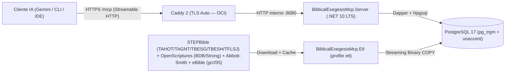

# Biblical Exegesis MCP Server


-4169E1?logo=postgresql&logoColor=white)

-2496ED?logo=docker&logoColor=white)

Servidor **Model Context Protocol (MCP)** dedicado à **exegese acadêmica de toda a Bíblia (66 livros)** — **Antigo Testamento Massorético (Hebraico e Aramaico Bíblico)** e **Novo Testamento Grego (Família 35 + Textus Receptus e variantes)** — construído em **C# / .NET 10 (LTS)** e **PostgreSQL 17**, 100% isolado via **Docker Compose** e otimizado para rodar localmente ou na **Oracle Cloud Always Free (OCI — inclusive na VM `E2.1.Micro` de 1 GB de RAM)**.

O objetivo do projeto é conectar clientes de IA (Gemini, Antigravity, Gemini CLI e clientes MCP) a um motor lexicográfico, morfológico e de concordância determinístico — garantindo **zero alucinação** em definições, ocorrências textuais, códigos de Strong (`Hxxxx` e `Gxxxx`), raízes semíticas e análises morfológicas (**OSHM/TEHMC** no AT e **Robinson** no NT).

---

## O que você pode perguntar (Exemplos de Uso)

### 1. Exegese e análise palavra por palavra — AT e NT (`parse_verse`)
- **AT Hebraico (TM padrão):** *"Faça a análise morfológica completa de Gênesis 1:1–3 no Texto Massorético."*
- **AT Aramaico Bíblico:** *"Analise Daniel 7:13 em aramaico bíblico, identificando os binyanim (Peal, etc.)."*
- **Notas Massoréticas (Qere/Ketiv e BHS):** *"Mostre Gênesis 27:3 e Salmos 22:16 com notas de Qere/Ketiv, variantes e numeração da BHS."*
- **NT Grego (Família 35 padrão + TR):** *"Analise João 1:1–5 na Família 35 e compare 1 João 5:7–8 entre Família 35, Textus Receptus, Bizantino e NA28."*

### 2. Estudo lexical aprofundado — BDB, Abbott-Smith, LSJ e Strong (`lookup_strong`)
- **AT (`Hxxxx`):** *"Dê o estudo léxico completo de `H2617` (חֶסֶד) e `H1254` (בָּרָא) com raiz, TWOT, Strong Hebraico e o verbete integral do Brown-Driver-Briggs (BDB)."*
- **NT (`Gxxxx`):** *"Mostre `G3056` (λόγος) com TBESG, Strong, Abbott-Smith (equivalentes hebraicos LXX e sinônimos) e o verbete integral do LSJ."*

### 3. Descoberta de lemas em Hebraico, Aramaico ou Grego (`search_lemma`)
- **Hebraico sem vogais (niqqud):** *"Procure por `בראשית`, `חסד` ou `אלהים`."*
- **Grego sem acentos/espíritos:** *"Procure por `λογος` ou `αγαπη`."*
- **Transliteração ou glosa em inglês:** *"Busque termos do AT para `covenant` (`testament="ot"`) ou do NT para `grace` (`testament="nt"`)."*

### 4. Concordância completa no AT e no NT (`word_occurrences`)
- *"Liste todas as ocorrências de `H1254` (בָּרָא) em Gênesis no Texto Massorético com forma destacada e análise OSHM."*
- *"Mostre todas as ocorrências de `G0026` (ἀγάπη) em 1 Coríntios na Família 35 ou no Textus Receptus."*

### 5. Estudos intertestamentários compostos (AT + NT)
- *"Compare `H2617` (חֶסֶד) no BDB com `G1656` (ἔλεος) e `G5485` (χάρις) no Abbott-Smith, analisando Salmos 23:6 no Texto Massorético e Efésios 2:8–9 na Família 35."*

---

## Fontes de Dados Abertas e Atribuição (100% Livres)

Todo o corpus (16 fontes versionadas em [datasets.json](src/BiblicalExegesisMcp.Etl/datasets.json)) é ingerido via `COPY` binário em ~31s:

| Escopo | Dataset | Volume Ingerido | Fonte / Licença |
| :---: | :--- | :---: | :--- |
| **AT** | **STEPBible `TAHOT`** (4 arquivos: Gen–Mal) | 305.634 palavras (39 livros, WLC/Leningrado, Qere/Ketiv e variantes) | [STEPBible/STEPBible-Data](https://github.com/STEPBible/STEPBible-Data) (CC BY 4.0) |
| **AT** | **OpenScriptures `BrownDriverBriggs.xml` + `LexicalIndex.xml`** | 12.297 verbetes BDB completos + raízes + TWOT | [openscriptures/HebrewLexicon](https://github.com/openscriptures/HebrewLexicon) (Domínio Público / CC BY 4.0) |
| **AT** | **OpenScriptures `HebrewStrong.xml`** | 8.674 verbetes Strong Hebraico/Aramaico | [openscriptures/HebrewLexicon](https://github.com/openscriptures/HebrewLexicon) (Domínio Público / CC BY 4.0) |
| **AT** | **STEPBible `TBESH`** *(somente metadados CC BY 4.0)* | 11.682 códigos `dStrong`, glosas e transliterações | [STEPBible/STEPBible-Data](https://github.com/STEPBible/STEPBible-Data) (CC BY 4.0) |
| **NT** | **Família 35 (`f35` — Padrão NT)** | 7.954 versos / 139.854 tokens (`98,33%` alinhados deterministicamente sem alucinação) | [eBible.org (`grcf35`)](https://ebible.org/find/details.php?id=grcf35) |
| **NT** | **STEPBible `TAGNT`** (Mat–Jhn + Act–Rev) | 142.095 tokens (`TR`, `Byz`, `NA28`, `SBL`, `WH`, `Treg`, `Tyn`) | [STEPBible/STEPBible-Data](https://github.com/STEPBible/STEPBible-Data) (CC BY 4.0) |
| **NT** | **STEPBible `TBESG` & `TFLSJ`** | 11.035 entradas TBESG + 10.957 verbetes LSJ | [STEPBible/STEPBible-Data](https://github.com/STEPBible/STEPBible-Data) (CC BY 4.0) |
| **NT** | **Abbott-Smith TEI XML** | 5.896 verbetes (acepções, sinônimos e equivalentes LXX) | [translatable-exegetical-tools/Abbott-Smith](https://github.com/translatable-exegetical-tools/Abbott-Smith) |
| **NT** | **Strong's Greek XML** | 5.624 verbetes originais de Strong | [morphgnt/strongs-dictionary-xml](https://github.com/morphgnt/strongs-dictionary-xml) |

> **Nota de licenciamento:** Do arquivo `TBESH` extraímos exclusivamente os campos licenciados sob **CC BY 4.0** pela STEPBible (`eStrong`, `dStrong`, lema, transliteração, classe e glosa curta), ignorando a coluna de definições de terceiros e utilizando o **Brown-Driver-Briggs (BDB)** completo e aberto do `openscriptures/HebrewLexicon`.

---

## Ferramentas MCP Expostas (`/mcp`)

| Tool | Parâmetros | Descrição |
| :--- | :--- | :--- |
| **`lookup_strong`** | `code`, `detail_level="standard"`, `lsj_offset=0`, `lsj_max_chars=12000` | Aceita `Hxxxx` (Strong Hebraico + raiz + TWOT + **BDB** resumo/full) e `Gxxxx` (TBESG + Strong + **Abbott-Smith** + **LSJ** resumo/full). |
| **`search_lemma`** | `query`, `fuzzy=true`, `limit=15`, `testament="all"` | Busca em Hebraico/Aramaico (sem niqqud/cantilação + raízes), Grego (sem diacríticos + `ς→σ`), transliteração e glosas EN com `pg_trgm`. |
| **`word_occurrences`** | `lemma_or_strong`, `edition=auto`, `book=null`, `limit=30`, `offset=0` | Concordância no AT (`mt` padrão, `ketiv`, `all`) ou no NT (`f35` padrão, `tr`, `byz`, `na28`, `sbl`, `all`), com contexto em negrito e morfologia em português. |
| **`parse_verse`** | `reference`, `edition=auto`, `include_variants=true` | Análise palavra por palavra para os **66 livros** (PT/EN, até 30 versos): **OSHM/TEHMC** + Notas Massoréticas/Qere-Ketiv no AT; **Robinson** + comparação **F35/TR/Byz/NA28** no NT. |

---

## Arquitetura



---

## Execução Local (Docker Compose — Zero Instalação no Host)

```bash
cp .env.example .env

# 1. Subir PostgreSQL 17
docker compose up -d db

# 2. Rodar ETL completo (66 livros: AT TM + NT Grego em ~31s)
docker compose --profile etl run --rm --build etl

# 3. Subir servidor MCP em http://localhost:8080/mcp
docker compose up -d --build mcp-server

# 4. Verificar saúde e contagens
curl http://localhost:8080/health
```

### Testes Unitários em Container (60 testes xUnit)

```bash
docker build -f Dockerfile.test -t biblical-exegesis-mcp-tests . && docker run --rm biblical-exegesis-mcp-tests
```

### Teste Temporário no Gemini Web (Cloudflare Tunnel em Docker)

```bash
docker run -d --rm --name greek-nt-tunnel \
  --network mcp-exegesis_default \
  cloudflare/cloudflared:latest tunnel --no-autoupdate --url http://mcp-server:8080

docker logs greek-nt-tunnel 2>&1 | grep -oE 'https://[a-z0-9-]+\.trycloudflare\.com' | head -n1
```

---

## Deploy na Oracle Cloud Always Free (OCI — VM `E2.1.Micro` 1 GB RAM ou `Ampere A1`)

O override [docker-compose.oci.yml](docker-compose.oci.yml) vem ajustado para rodar com folga mesmo na VM **Always Free de 1 GB de RAM** (`db` `288m`, `mcp-server` `288m` com `DOTNET_GCHeapHardLimit=256MB`, `caddy` `96m`, além de ETL em streaming para `TAHOT`):

1. Aponte um domínio/DDNS (ex.: DuckDNS/Cloudflare) para o IP público reservado da VM.
2. Libere `80/tcp` e `443/tcp` na **VCN Security List** e no `iptables` da VM:
   ```bash
   sudo iptables -I INPUT 6 -m state --state NEW -p tcp --dport 80 -j ACCEPT
   sudo iptables -I INPUT 6 -m state --state NEW -p tcp --dport 443 -j ACCEPT
   sudo netfilter-persistent save
   ```
3. Configure `.env` (`chmod 600 .env`) com `POSTGRES_PASSWORD`, `MCP_DOMAIN` e `MCP_API_KEY` (`openssl rand -hex 32`) e suba:
   ```bash
   docker compose -f docker-compose.yml -f docker-compose.oci.yml up -d db
   docker compose -f docker-compose.yml -f docker-compose.oci.yml --profile etl run --rm --build etl
   docker compose -f docker-compose.yml -f docker-compose.oci.yml up -d --build mcp-server caddy
   curl https://seu-dominio.com/health
   ```

---

## Configuração em Clientes MCP (Gemini CLI / Antigravity)

```json
{
  "mcpServers": {
    "biblical-exegesis": {
      "httpUrl": "https://seu-dominio.com/mcp",
      "headers": {
        "Authorization": "Bearer SEU_MCP_API_KEY"
      }
    }
  }
}
```
*(Para testes locais, use `"httpUrl": "http://localhost:8080/mcp"` sem `headers`.)*
